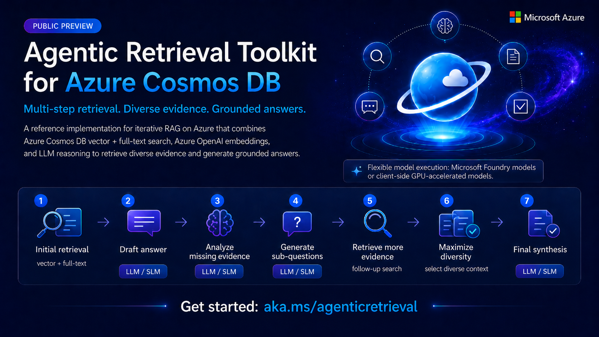

# Agentic Retrieval



Agentic Retrieval is a multi-stage agentic retrieval accelerator for answering complex questions that typically require multi-hop reasoning. It is a self-correcting RAG system that iteratively identifies knowledge gaps, retrieves targeted evidence, and generates more complete answers — built on Azure Cosmos DB for NoSQL and Microsoft Foundry.

Instead of relying on a single search-and-answer pass, the pipeline interleaves retrieval and reasoning across multiple rounds. Tool-use mode lets the LLM choose searches within an enforced research budget. Decomposed mode drafts a preliminary answer, identifies gaps, generates focused sub-questions, and retrieves and synthesizes evidence over a configured number of refinement cycles.

## Useful for scenarios with…

- **Complex questions** that span multiple topics or require information from many documents and modalities.
- **High-stakes applications** where answer completeness and accuracy matter (legal, medical, financial, real-estate, etc.).
- **Large heterogeneous corpora** where a single search query can't surface all relevant information.
- **Enterprise knowledge bases** with structured and unstructured data across multiple collections.

## How it works

Agentic Retrieval has two stages:

1. **Ingestion (`cosmos_db_upload.py`)**
   - Reads documents from one or more configured sources (JSONL by default; custom parsers for other formats such as XML).
   - Builds embeddings with the configured Azure OpenAI / Foundry endpoint and stores them in the per-source embedding field (e.g. `e`).
   - Upserts documents into Azure Cosmos DB containers with vector and full-text indexing enabled.

2. **Retrieval and answering (`dynamic_retriever.py`)**
   - Supports bounded **tool-use** (the default) and structured **decomposed** retrieval across all configured sources.
   - Combines vector and full-text search with optional semantic reranking; decomposed mode additionally supports diversity selection and explicit sub-question refinement.
   - Checkpoints tool-use results or writes decomposed per-question traces and grouped answer files under `out/`.

> **Note:** This package can optionally use the **Azure Cosmos DB Semantic Reranker**
> to reorder retrieved results by semantic relevance before answer synthesis. It is
> enabled via the `ranker` settings in `config.yaml` (set `ranker.use_ranker: true`)
> and can be left disabled if you don't have a reranker resource. Learn more:
> <https://aka.ms/build26/cosmosreranker>.

## What this project does

- Uploads your corpus to Cosmos DB through **configurable sources** (`cosmos.sources`), each mapping to a container.
- Embeds all sources with one configured embedding endpoint/model.
- Answers evaluation questions by combining:
  - Initial retrieval
  - Gap-aware sub-question decomposition
  - Regeneration/synthesis into a final answer

## Prerequisites

- Python 3.10+
- Azure Cosmos DB account + database/containers (or management settings for auto-create)
- Azure OpenAI (or local embedding endpoint if configured)

Install dependencies:

```bash
pip install -r requirements.txt
```

Or use setup helpers:

- PowerShell: `./run.ps1`
- Bash: `source ./run.sh`

## Using this project as a library

This repository isn't published to PyPI, but it has minimal packaging metadata
(`pyproject.toml`) so it can be installed straight from GitHub into another
Python project via pip's Git support:

```bash
pip install "git+https://github.com/AzureCosmosDB/AgenticRetrieval.git@main"
```

Pin to a commit SHA or tag instead of a branch for reproducible installs.

The reusable entry points are `cosmos_db_upload.py`, `dynamic_retriever.py`,
and `timing_summary.py`, plus their direct local dependencies
(`greedy_log_det.py`, `prompts.py`, `utils/fulltext.py`, `utils/ranker.py`):

```python
import cosmos_db_upload  # document ingestion, embedding, and Cosmos upsert
from dynamic_retriever import ...  # decomposed/agentic RAG pipeline over Cosmos DB
import timing_summary
```

Sample configs, `tests/`, `docs/`, and `data/` are not part of the installable
package. The upload and retrieval scripts still require a configured YAML file
and access to the relevant Cosmos DB and model endpoints.

## Sequence of actions

### 1) Populate `config.yaml`

Start from `config.yaml.example` and fill required values in `config.yaml`. Make sure to use the latest `config.yaml.example` as the format might have been updated.

At minimum, set:

- `llm.llm_endpoint`
- `llm.embed_endpoint`
- `llm.llm_model`
- `llm.embed_model`
- `llm.azure_openai_key` (if not using RBAC for OpenAI, i.e., `llm.use_rbac_auth: false`)
- `cosmos.uri`
- `cosmos.database_name`
- `cosmos.sources` (one or more source entries)
- `paths.output_root`

Each entry in `cosmos.sources` is configured independently and includes:

- `id`
- `container_name`
- `partition_key_path`
- `embedding_field` (document field that stores embedding vectors, e.g. `e`)
- `documents_root`
- `embedding_text_fields`
- `retrieval.vector_k`
- `retrieval.fulltext_k`
- `retrieval.fulltext_fields`
- `indexing_policy_json`
- `full_text_policy_json`

**Authentication options:**

- **Cosmos DB**: Uses Entra ID RBAC by default (`cosmos.use_rbac_auth: true`).
  - Set `cosmos.use_rbac_auth: false` to use key-based auth (requires `cosmos.key`).
  - For RBAC: Ensure your identity has the "Cosmos DB Built-in Data Contributor" role assigned.

- **Azure OpenAI**: Uses key-based auth by default (`llm.use_rbac_auth: false`).
  - Set `llm.use_rbac_auth: true` to use Entra ID RBAC (requires `llm.token_scope`).

Optional but recommended for auto-creating missing containers:

- `cosmos.azure_subscription_id`
- `cosmos.cosmos_resource_group`
- `cosmos.cosmos_account_name` (or let script infer from `cosmos.uri`)

### 2) Upload documents to Cosmos DB

Run:

```bash
python cosmos_db_upload.py --config config.yaml
```

Notes:

- Upload target(s) are inferred from configured `cosmos.sources` entries with non-empty `documents_root`.
- Use `--source <id>` to upload just one configured source; unknown IDs fail before connecting.
- Newline-delimited JSON inputs support `.jsonl`, `.ndjson`, and `.jsonlines` extensions
  (case-insensitive), both as individual source files and within source directories.
- For the two product files configured in `config.products.yaml`, run
  `.\upload-products.ps1` in PowerShell. It uploads each source separately, uses the
  repository's `.venv` Python when available (otherwise `python`), and stops on a
  nonzero command exit code. Existing containers' indexing policies are not updated.
- Embedding batches retry HTTP 408/409/429/5xx responses and connection errors
  (including SDK timeouts) with exponential backoff. Lower `cosmos.concurrent_batches` and
  `cosmos.embedding_batch_size` if requests frequently time out.
- Reruns skip documents by their generated ID and configured source partition key.
  Keep input filenames and JSONL record ordering unchanged when resuming; those
  determine generated IDs. Existing documents are skipped, not refreshed.
- For directory JSONL/NDJSON inputs, IDs include the source-root-relative path
  (with normalized `/` separators) and line number, so same-named files in
  different subdirectories remain distinct. Single-file input IDs are unchanged.
  Resuming a directory upload created with older basename-only IDs requires
  migration or a clean target; nested-file IDs now differ.
- Existence checks support undefined partition keys as well as explicit JSON
  null; an absent nested parent is treated as undefined, not an upload error.
- After reporting the upload summary and closing clients, the uploader exits
  with a nonzero code if any documents failed.
- Tenant-scoped Cosmos authentication allows 60 seconds for each Azure CLI token
  request. Temporary CLI process timeouts are retried during existence checks and
  writes; persistent authentication failures are raised rather than treated as
  missing documents. If CLI failures persist, verify `az account show` and
  `az login --tenant <tenant-id>` in the same terminal before resuming.

### 3) Run retrieval and generate answers

Both retrieval modes use an expiry-aware Entra token provider for semantic
reranking, refreshing tokens during long runs. HTTP 401/403 responses are reported
without repeatedly retrying the same unauthorized request. By default, ranker
failures keep the unranked/diversity-selected fallback; consult the run log when
assessing answer quality. Set `ranker.fail_on_error: true` to fail visibly instead:
the ranker token is acquired at startup (a failure aborts the run with a clear
message), and any later ranker failure aborts the run rather than silently
returning unranked results. With the default `false`, a startup token failure is
only logged. A fatal runtime ranker failure in decomposed mode cancels remaining
questions, closes clients and exits nonzero; completed per-question traces remain
under the run's `intermediate/` directory.

Both retrieval modes project document IDs and each source's partition key during
vector and full-text candidate searches (plus vector distance for vector
candidates). At startup the partition key path is read from the container
definition (`partitionKey.paths`) for every source that is searched. The
configured `partition_key_path` is used only if the container definition cannot
be read, and a mismatch is logged. A missing or invalid path, a container
without a partition key, or a hierarchical partition key stops the run with a
clear error. Full-text field lists are fused with the same
client-side RRF as before. Candidates are then merged by container, partition
key and document ID, and full documents are fetched once per unique candidate
using partition-aware point reads with at most 16 concurrent reads per search.
Container identity includes the account, database and container, so source aliases
that use separate SDK proxies for the same container still share a candidate.
Ranking, formatting and diversity selection run on those full documents,
including their existing embeddings. Timing logs report this post-merge stage
as `fetch candidates`. A point read that fails with HTTP 404 (for example a
document deleted since the query) or 429 is logged and that candidate is
skipped; other point-read errors still propagate.
The QA CLI vector baseline also resolves partition paths and fetches full
documents after candidate merging before constructing answer context.

Configured `fulltext_fields` that are not dotted identifiers (with an optional
trailing `[]`) are skipped with a warning at startup in both modes. In decomposed
mode, full-text index paths read from the container policy are validated once,
unsupported ones are skipped with a warning, and the result is cached.

For string-array full-text fields, configure a terminal `[]` in
`retrieval.fulltext_fields` (for example `derived_attributes[]`) and the matching
`/derived_attributes/[]` path in both `fullTextIndexes` and `fullTextPaths`.
Both retrieval modes use an `EXISTS` subquery with `FullTextContainsAny` on each
array element, returning each matching document once. Scalar fields retain BM25
ranking. Array candidates are limited by `fulltext_search_k` without BM25 ordering;
their order in multi-field fusion is not a relevance score. Broad array queries
can therefore omit relevant documents beyond that limit. Arrays and embeddings
are unchanged. Live query diagnostics may report the array path as a potential
index rather than an utilized index; do not assume these predicates are
index-accelerated without checking diagnostics for the deployed service.

Tool-use mode atomically checkpoints full answers and per-question
`elapsed_seconds` to its results JSON after every completed question, preserving
completed work if a later question fails or the process is stopped.

#### Choose a mode and understand its limits

The CLI `--mode` overrides `pipeline.mode`; if neither is set, the default is
`tool-use`. The modes do **not** share a round limit:

| Setting | Applies to | Meaning |
| --- | --- | --- |
| `pipeline.max_search_rounds` | Tool-use only | Follow-up search turns after the one initial search; parallel queries count as one turn. Default: 4; minimum: 0. |
| `pipeline.max_agent_turns` | Tool-use only | Safety cap on research/control turns, including pruning, invalid calls and retries. Default: 50; minimum: 1. |
| `pipeline.rounds` / `--rounds` | Decomposed only | Gap-analysis, sub-question retrieval and answer-refinement cycles after initial retrieval and a preliminary answer. Default: 2. |

For example:

```yaml
pipeline:
  mode: tool-use
  max_search_rounds: 4
  max_agent_turns: 50
  rounds: 2                # Used only when mode is decomposed
```

```bash
# Bounded agent-driven research; uses max_search_rounds and max_agent_turns
python dynamic_retriever.py --config config.yaml --mode tool-use --timing

# Initial retrieval/preliminary answer, then two structured refinement cycles
python dynamic_retriever.py --config config.yaml --mode decomposed --rounds 2 --timing
```

These commands use `paths.questions_path` and `paths.output_root`; override
them with `--questions-path` and `--output-root` as needed.

`initial_search` executes at most once per question. `max_search_rounds` counts
follow-up turns that request searches (parallel queries count as one turn);
zero allows only initial retrieval before final synthesis. `max_agent_turns`
is a separate safety cap covering research, pruning, invalid calls and retries.
Both limits must be integers; search rounds may be zero and agent turns must
be positive. Defaults are 4 and 50.

Explicit pruning, automatic pruning and context-overflow recovery retain an
independent progress ledger: completed initial retrieval, attempted queries,
source-backed finding excerpts, assistant notes and the latest gap analysis.
Notes and gaps are provisional, not additional source evidence. Compacted
context includes this progress plus retained documents, rather than restarting
the workflow. When context is too small for all finding excerpts, omissions
are logged; the complete ledger remains in the saved result. Full retrieved
documents remain cached for explicit pruning during the question.

At either limit the runtime disables research tools and requires `final_answer`,
with instructions to identify unmet requirements and unverified facts. Final
synthesis has at most `llm.max_retries` attempts (at least one), separate from
the research-turn cap. Empty or malformed answers are not accepted as success.
Tool-use results include `status`, `termination_reason` and `research_progress`:

| Status | Meaning |
| --- | --- |
| `completed` | A nonempty answer was produced, either normally or through forced synthesis. `research_budget_exhausted` identifies planned budget-based finalization; it does not mean every requirement was verified. |
| `partial` | The agent-turn safety cap was reached and forced synthesis produced an answer (`termination_reason: agent_turn_limit`). |
| `failed` | No valid answer could be produced, for example `finalization_failed` or `llm_error`. The record includes an explicit `error`; an empty answer is never marked successful. |

Failed records are checkpointed and processing continues to the remaining
questions; the CLI exits nonzero after saving the run if any records failed.
Partial answers are explicitly marked but do not alone cause a nonzero exit.
The `rounds` result field counts agent and final-synthesis LLM attempts, not
decomposed refinement cycles. No limit can guarantee that every user requirement
is supported by the available corpus.

Before running retrieval, prepare your questions file.

The repository includes a sample file at `data/questions-answers.json` with this structure:

```json
[
  {
    "question_id": "1",
    "question_text": "Your question here",
    "answer": "Ground-truth answer here"
  }
]
```

How to use it:

- Keep the same JSON array structure and field names (`question_id`, `question_text`, `answer`).
- Replace `question_text` values with questions your own dataset should be able to answer.
- Replace `answer` values with your own ground-truth answers (the expected/correct answers you define for evaluation).

Then run:

```bash
python dynamic_retriever.py --config config.yaml --questions-path path/to/questions.json
```

`--config` is required. `--questions-path` optionally overrides
`paths.questions_path` and points to a single `.json` file containing the
question array.

The paradigm is selected by `--mode {tool-use,decomposed}` (CLI flag) or `pipeline.mode` in YAML; the CLI overrides the config. The default when neither is set is `tool-use`.

Typical limited smoke test:

```bash
python dynamic_retriever.py --config config.yaml --questions-path data/questions-answers.json --max-questions 1
```

### 4) Generate timing summary table

Run:

```bash
python timing_summary.py
```

What this script does:

- Runs a fresh timed benchmark (`dynamic_retriever.py --mode decomposed --config config.yaml --questions-path <questions_file> --max-questions 5 --timing`).
- Parses key retrieval/LLM timing checkpoints from the terminal output.
- Writes a timestamped log in `out/` (`timing_5q_rerun_<timestamp>.log`).
- Updates `out/timing_5q_latest.log` with the newest run.
- Generates a table at `out/timing_5q_compare_table.tsv`:
  - If no previous latest log exists: prints/writes `Component` + `This run`.
  - If previous latest log exists: prints/writes `Component`, `Prev run`, `This run`, and `Change`.

Outputs are written to:

- `out/k.../intermediate/...` (decomposed per-question traces)
- `out/k.../<questions-stem>_<timestamp>.json` (decomposed grouped answers)
- `out/standard/results_<timestamp>.json` (tool-use answer/status/progress checkpoints)

## Useful runtime overrides

These flags override the corresponding `config.yaml` values for a single run (decomposed mode unless noted):

- `--k-diverse` — number of diverse chunks to select via log-determinant (MMR-style) selection; `0` disables diversity selection.
- `--eta` — Gram-matrix regularization strength used by the diversity selection.
- `--rescale-power` — exponent applied to query-similarity scores when rescaling before diversity selection.
- `--max-sub-questions` — maximum number of gap-filling sub-questions generated per round.
- `--rounds` — decomposed refinement cycles only; does not limit tool-use turns or searches.
- `--max-questions` — only answer the first N questions from the questions file (both modes; handy for smoke tests).
- `--max-workers` — number of questions processed concurrently.
- `--questions-path` — path to the questions `.json` file (both modes; overrides `paths.questions_path`).
- `--output-root` — directory where traces and answer files are written (both modes; overrides `paths.output_root`).

Tool-use search/turn budgets are YAML settings, not CLI flags. `--timing` is
available in both modes. Tool-use gap analysis is an optional tool the agent
may call; it is not the mandatory gap/sub-question stage of decomposed mode.

### `--timing` — wall-clock profiling

Add `--timing` to print a checkpoint line for every major operation as it completes:

```bash
python dynamic_retriever.py --mode decomposed --config config.yaml --questions-path data/questions-answers.json --max-questions 1 --timing
```

Each line has the form:

```text
  [TIMING] <label>: +<step_elapsed>s  (total <since_start>s)
```

Immediately before each Cosmos DB call, the actual query is also printed as a `[QUERY]` line.

## Repository layout

- `cosmos_db_upload.py` — ingestion + embedding + Cosmos upsert
- `dynamic_retriever.py` — bounded tool-use and decomposed RAG retrieval/answer pipelines
- `timing_summary.py` — timed rerun + timing comparison table generation
- `config.yaml.example` — sample data config template for files under `data/`
- `data/` — sample input corpus
- `docs/` — concepts and detailed usage docs for the root/sample-data pipeline
- `samples/` — standalone example apps built on the pipeline (see below)
- `out/` — generated outputs

## Samples

The `samples/` folder contains standalone apps that build on the retrieval pipeline:

- [`samples/QA_CLI`](samples/QA_CLI/) — an interactive terminal app to ask a question and compare retrieval strategies: **tool-use** (agentic function-calling loop), **decomposed** (Agentic Retrieval multi-round RAG), a single-shot **vector** search baseline, or **compare** to run all three side by side. See its [README](samples/QA_CLI/README.md) for setup and usage.

## Troubleshooting

- **Azure OpenAI auth errors (401/403)**
  - If using key auth (`llm.use_rbac_auth: false`), ensure `llm.azure_openai_key` is valid and maps to the configured endpoint.
  - If using RBAC (`llm.use_rbac_auth: true`), make sure your signed-in identity has Azure OpenAI access and `llm.token_scope` is correct.

- **Cosmos DB auth errors (403/Forbidden)**
  - If using RBAC (`cosmos.use_rbac_auth: true`, the default), ensure your identity has the appropriate Cosmos DB data plane role.
  - If using key auth (`cosmos.use_rbac_auth: false`), ensure `cosmos.key` is valid.

- **A source is skipped during upload**
  - Check source-level required fields:
    - `container_name`
    - `partition_key_path`
    - `documents_root`

- **Missing container during upload**
  - Auto-create works only when management settings are present:
    - `cosmos.azure_subscription_id`
    - `cosmos.cosmos_resource_group`
    - optional `cosmos.cosmos_account_name`

- **No questions processed / empty output**
  - Confirm `--questions-path` points to a `.json` file containing a JSON array of question objects.
  - Each object must have `question_id` and `question_text` fields.
  - Confirm `--output-root` (or `paths.output_root` in config) is writable.

- **Config error: `cosmos.sources` missing/empty**
  - Both upload and retrieval now fail fast when `cosmos.sources` is not a non-empty list.
  - Add at least one source entry under `cosmos.sources` with required properties.
